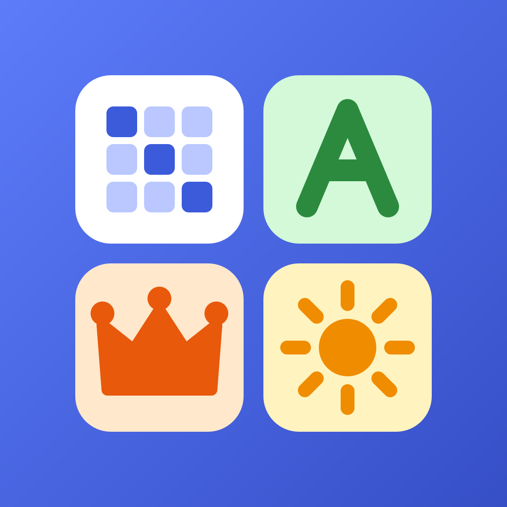

<p align="center">
  
</p>

<h1 align="center">Pasaratos</h1>

<p align="center"><b>Pasatiempos para cada rato.</b> 17 juegos de números, palabras y lógica, con reto del día, niveles, logros y estadísticas.</p>

<p align="center"><a href="https://martamacfly.github.io/pasaratos/">▶ Jugar en el navegador</a> · App para Android (APK) generada con EAS</p>

<p align="center">Creado por <a href="https://martamacfly.github.io/piconeratech">Piconera Tech</a></p>

---

## Juegos

| Números | Palabras | Lógica y trazos |
|---|---|---|
| Sudoku | Palabra oculta | Reinas |
| Futoshiki | Crucigrama | Buscaminas |
| Calcudoku | Sopa de letras | Nonograma |
| Binario | Grupos de 4 | Camino numerado |
| | Autodefinido | Conectar colores |
| | Criptograma | Descifrar el código |
| | | Puzzle deslizante |

Los tableros se generan al azar, y los de lógica tienen siempre una sola solución. Grupos de 4 (60 partidas) y los refranes del Criptograma (80) están escritos a mano. Cada juego explica sus reglas en su pantalla.

## Funciones

- **Reto del día:** cada día, un tablero de cada juego, el mismo para todo el mundo. Lleva la cuenta de los días seguidos y cada reto ganado da una pista más para ese juego.
- **Niveles:** cada dificultad tiene 50 niveles fijos que se desbloquean al completar el anterior. Al entrar se abre el primero sin completar, y los ya superados muestran una tarjeta para repetirlos o seguir.
- **Pistas:** cada juego empieza con 3 pistas para la partida libre (rellenan una casilla, revelan una letra, resuelven un grupo…).
- **Logros:** 19 medallas de bronce, plata y oro por partidas ganadas, rachas, niveles completados y retos especiales, con aviso al conseguir una nueva.
- **Estadísticas:** partidas resueltas, tiempo jugado, juego favorito, calendario de retos, intentos de Palabra oculta y progreso por juego y dificultad.
- **Favoritos:** una estrella en cada juego (en el menú o en su pantalla) lo pone el primero del menú.
- **Compartir:** niveles completados, retos del día y logros, como texto (directo a WhatsApp, X, Facebook o Telegram) o como imagen con el logo, que en el móvil se comparte en cualquier red social y en el ordenador se descarga.
- **Ajustes:** tema claro, oscuro o automático, texto grande, modo para daltónicos, cronómetro opcional, marcar errores al momento, resaltado en Sudoku, confirmar antes de reiniciar, vibración, confeti, recordatorio diario (en el móvil) y copia de seguridad del progreso.
- **Guardado automático:** cada partida se guarda y se retoma donde se dejó, con tiempos y récords por dificultad.
- **Comodidades:** deshacer en los juegos de tablero, notas en el Sudoku, teclado físico en los juegos de palabras en el navegador.
- **Diseño adaptable:** en el móvil, una columna; en el ordenador, el tablero grande y un panel lateral con los controles. Cada juego tiene su color y sus iconos, dibujados en lugar de emojis para que se vean igual en todos los dispositivos.

## Tecnología

- [Expo](https://expo.dev) SDK 58 con React Native y TypeScript.
- [Expo Router](https://docs.expo.dev/router/introduction/) para la navegación: cada pantalla es un archivo en `src/app/`.
- `react-native-svg` para los iconos y `@react-native-async-storage/async-storage` para guardar el progreso en el dispositivo. No hay servidor ni cuentas.
- `expo-haptics` (vibración), `expo-notifications` (recordatorio), `expo-sqlite/kv-store` (ajustes leídos al arrancar), `expo-clipboard`, `expo-sharing` y `react-native-view-shot` (imágenes para compartir).
- La web se exporta como sitio estático y se publica en GitHub Pages en cada push a `master` ([`.github/workflows/pages.yml`](.github/workflows/pages.yml)).
- La app de Android se compila en la nube con [EAS Build](https://docs.expo.dev/build/introduction/) (`eas.json`).

## Cómo ejecutarlo

Necesitas [Node.js](https://nodejs.org) 20 o posterior.

```bash
npm install
npx expo start
```

Después:

- **En el móvil:** instala la app **Expo Go** (Android o iPhone) y escanea el código QR que aparece en la terminal.
- **En el navegador:** pulsa `w` en la terminal, o ejecuta `npm run web`.

Para comprobar los tipos:

```bash
npm run typecheck
```

Para generar la versión web como hace la publicación (sale en `dist/`):

```bash
npx expo export -p web
```

### Generar la APK de Android

Con una cuenta de Expo e iniciada la sesión (`npx eas-cli@latest login`):

```bash
npx eas-cli@latest build -p android --profile preview
```

Tarda unos 15 minutos. Al terminar, EAS da un enlace para descargar la APK e instalarla en el móvil. La versión de la app está en `app.json` (`expo.version`); el número interno de Android se sube solo en cada compilación. Las APK descargadas no se suben al repositorio.

## Estructura

```
src/
├── app/            Pantallas (una por juego) y navegación
│   ├── index.tsx         Menú principal con el reto del día y los favoritos
│   ├── logros.tsx        Logros
│   ├── estadisticas.tsx  Estadísticas
│   └── ajustes.tsx       Ajustes, copia de seguridad y créditos
├── games/          Lógica de cada juego: generadores, comprobaciones y contenido
│   ├── catalog.ts  Lista de juegos del menú
│   ├── grupos.ts   Partidas de Grupos de 4
│   ├── pistas.ts   Palabras y pistas de crucigrama y autodefinido
│   └── random.ts   Azar con semilla (reto del día y niveles)
├── components/     Piezas compartidas: diseño, barra de niveles, iconos, botones, menú e imagen para compartir
├── hooks/          Cronómetro, deshacer y arrastre con el dedo
├── daily.ts        Reto del día, rachas y texto para compartir
├── levels.ts       Progreso de niveles
├── achievements.ts Logros
├── hints.ts        Pistas de cada juego
├── favorites.ts    Juegos favoritos
├── settings.ts     Ajustes
├── social.ts       Textos e imágenes para compartir
├── shareImage.ts   Genera y comparte la imagen
├── theme.ts        Colores, modo oscuro y modo para daltónicos
└── storage.ts      Guardado de partidas y estadísticas
```

### Añadir contenido

- **Partidas de Grupos de 4:** añade una entrada a `PUZZLES` en `src/games/grupos.ts`. Son 4 grupos de 4 palabras, ordenados de más fácil a más difícil. Cada partida es un nivel.
- **Palabras de crucigrama:** añade `{ word, clue }` a `PISTAS` y su pista corta a `CORTAS` en `src/games/pistas.ts`. Las palabras van en mayúsculas y sin tildes; la Ñ sí se mantiene.
- **Refranes del Criptograma:** añádelos a `REFRANES` en `src/games/criptograma.ts`.

### Añadir un juego nuevo

1. La lógica, en `src/games/<juego>.ts`. Usa `random()` y `shuffle()` de `random.ts` en lugar de `Math.random()`, para que funcionen el reto del día y los niveles.
2. La pantalla, en `src/app/<juego>.tsx`, con `GameLayout`, `LevelBar`, `useDaily` y `useAutosave`. Puedes copiar la estructura de un juego parecido.
3. Regístralo en `src/games/catalog.ts`, `src/app/_layout.tsx` (título), `src/gameTheme.ts` (colores) y `src/components/icons.tsx` (icono).
4. Escribe sus reglas en el texto de ayuda de la pantalla y, si tiene sentido, una función de pista con `HintButton`.
